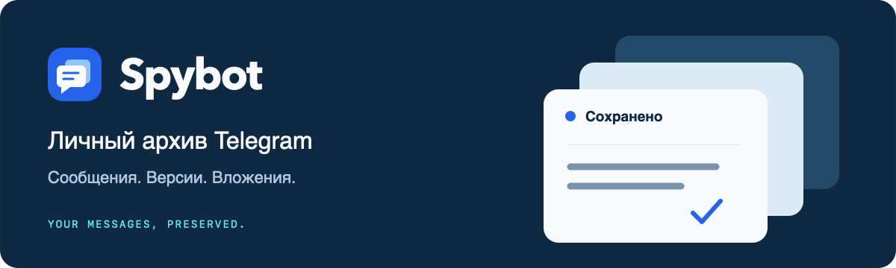

<p align="center">
  
</p>

<p align="center">
  <a href="https://github.com/mrvasil/telegram-spybot/actions/workflows/ci.yml?query=branch%3Arewrite%2Fpersonal-archive-v2"></a>
  
  
  
</p>

<p align="center">
  <a href="#быстрый-запуск">Запуск</a> ·
  <a href="docs/USAGE.md">Руководство</a> ·
  <a href="docs/DESIGN.md">Архитектура</a> ·
  <a href="PROGRESS.md">Состояние</a> ·
  <a href="CHANGELOG.md">Изменения</a>
</p>

Spybot сохраняет сообщения из подключённых чатов Telegram: текст, версии правок, события удаления и доступные вложения. Архив хранится на вашем сервере в зашифрованном виде. Управление — через личный чат с ботом, доступный только владельцу.

## Что внутри

| Возможность | Как это работает |
| --- | --- |
| История сообщений | Полученные правки собеседников сохраняются отдельными версиями; удаление в Telegram не стирает локальную копию. |
| Фото и другие файлы | Доступные вложения скачиваются в архив; при удалении отправляются прямо в чат истории без кнопок. |
| Удобные карточки | Выделение, цитаты, «Было / Стало» и навигация без новых сообщений на каждый клик. |
| Поиск и закладки | Поиск по сохранённым версиям, просмотр чатов и быстрый доступ к избранному. |
| Настройка уведомлений | Тихие часы, сводки и отключение уведомлений без остановки архивирования. |
| Экспорт и backup | JSONL + HTML, выгрузка файлов, зашифрованные копии и проверяемое восстановление. |

> [!IMPORTANT]
> Сохраняется то, что Telegram передал боту. Секретные чаты, недоставленная история и недоступные одноразовые файлы не восстанавливаются. Исчезающее фото можно сохранить, только если API предоставил файл и его удалось скачать вовремя.

## Быстрый запуск

Нужны Python 3.13, [uv](https://docs.astral.sh/uv/getting-started/installation/) и токен бота из BotFather.

```bash
git clone --branch rewrite/personal-archive-v2 https://github.com/mrvasil/telegram-spybot.git
cd telegram-spybot
uv sync --frozen
cp .env.example .env
chmod 600 .env
mkdir -p data && chmod 700 data
uv run spybot init --key-file "$HOME/.config/telegram-spybot/archive.key"
```

Заполните `.env`:

| Поле | Значение |
| --- | --- |
| `TOKEN` | Токен бота |
| `USER_ID` | Числовой Telegram ID владельца |
| `ARCHIVE_KEY_FILE` | Абсолютный путь к созданному ключу, вне `data/` |
| `TIMEZONE` | Часовой пояс, например `Europe/Moscow` |

```bash
uv run spybot run
```

В BotFather включите Secretary Mode (ранее Business Mode). Подключите бота в настройках своего Telegram-аккаунта и выберите чаты. Откройте `/start`, затем проверьте `/status`.

**Сохраните отдельную резервную копию ключа.** Без него нельзя открыть архив или восстановить backup.

<details>
<summary>Запуск в Docker</summary>

После подготовки `.env`, ключа и каталога данных укажите в `.env` значения `RUN_UID` и `RUN_GID` из `id -u` и `id -g`. Пути `DATA_DIR` и `ARCHIVE_KEY_FILE` должны указывать на файлы хоста.

```bash
docker compose up -d --build
docker compose ps
docker compose logs --tail=50 spybot
```

Данные и ключ подключаются отдельно от образа. Контейнер работает с read-only root filesystem. [Обновление, остановка и восстановление →](docs/USAGE.md)

</details>

## Каждый день

| Команда | Действие |
| --- | --- |
| `/archive`, `/deleted`, `/chats` | Открыть сообщения и чаты |
| `/search слова` | Найти сохранённый текст |
| `/bookmarks` | Открыть закладки |
| `/settings` | Настроить уведомления |
| `/export`, `/export_media` | Выгрузить архив без файлов или с ними |
| `/backup`, `/status` | Создать копию или проверить состояние |

Остальные действия доступны кнопками. [Полный список команд →](docs/USAGE.md#команды)

## Сохранность данных

Правки собственных сообщений владельца исключаются до записи входящего JSON: их тексты и вложения не сохраняются, уведомления не создаются. Исходные исходящие сообщения остаются в архиве. Telegram не сообщает автора удаления, поэтому события удаления по этому признаку не фильтруются. Уже существовавший архив автоматически не очищается.

Входящий JSON и следующий offset записываются одной транзакцией до подтверждения получения. Незнакомые поля API остаются в архиве. Скачивание файлов и уведомления работают в независимых постоянных очередях.

База и поисковый индекс зашифрованы SQLCipher, файлы — AES-256-GCM. Ключ хранится отдельно. Это шифрование на диске: работающий процесс имеет доступ к данным. По умолчанию срок хранения не ограничен. При нехватке места архив не очищается автоматически.

Облачный Bot API ограничивает скачивание файлов размером до 20 МБ. Для больших файлов предусмотрено подключение отдельного Local Bot API Server. [Ограничения и эксплуатация →](docs/USAGE.md#файлы-большого-размера)

## Разработка

```bash
uv run pytest -q
uv run ruff check src tests
uv run ruff format --check src tests
uv run mypy src/spybot
```

Для 2.0.2 проверены 132 теста на macOS и Linux AMD64. [Результаты и границы проверки →](docs/VERIFICATION.md)

| Документ | Для чего |
| --- | --- |
| [AGENTS.md](AGENTS.md) | Правила работы с кодом и данными |
| [CONTRIBUTING.md](CONTRIBUTING.md) | Настройка окружения и подготовка изменений |
| [PROGRESS.md](PROGRESS.md) | Что готово и что ещё не проверено |
| [ROADMAP.md](ROADMAP.md) | Следующие этапы |
| [SECURITY.md](SECURITY.md) | Модель доступа и сообщения об уязвимостях |
| [docs/DESIGN.md](docs/DESIGN.md) | Транзакции, очереди и шифрование |

Личный бот для одного владельца. Mini App запланирован отдельным этапом; миграция старой базы в этот выпуск не входит.
