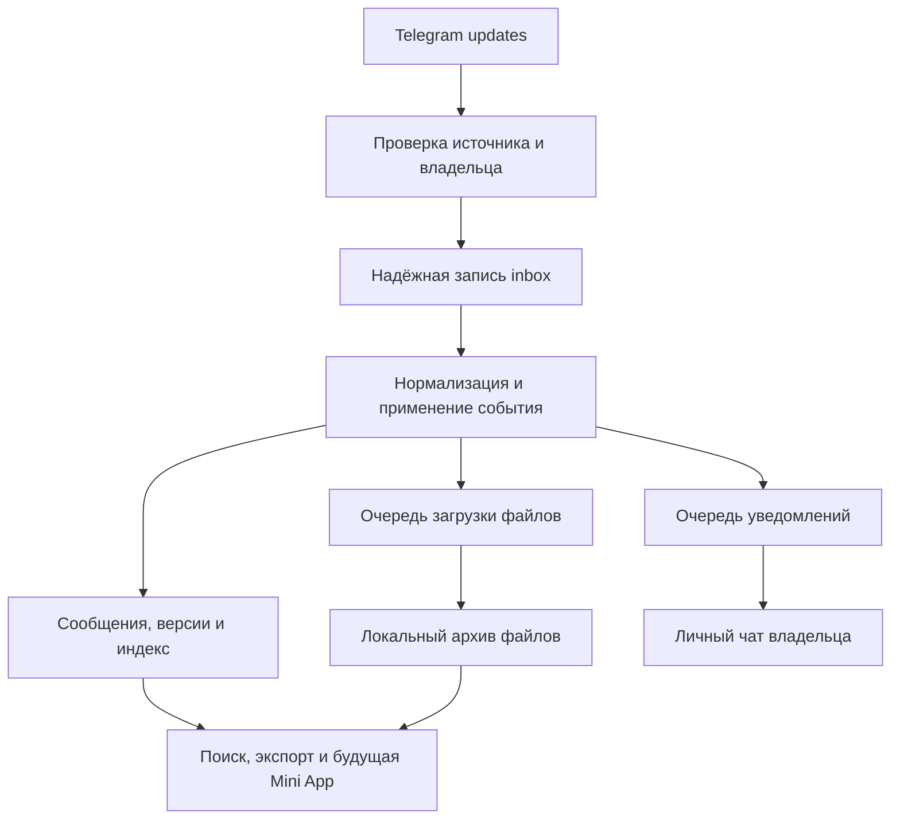

# Telegram Spy Bot 2.0 — план полной переработки

Дата: 14 ноября 2026 года. Основание: исходники на коммите `6d7ea51` и актуальная официальная документация Telegram. Статус: план; новая реализация ещё не создана.

## 1. Цель и согласованный объём

Создать надёжный личный архив сообщений из подключённых чатов Telegram: сохранять доступные боту сообщения и вложения, фиксировать полученные изменения и удаления, давать владельцу удобный поиск, историю, экспорт и управление хранением.

Пользователь выбрал:

- **Личный бот для одного владельца**, с расширенными возможностями.
- **Полноценный интерфейс внутри Telegram** в первом выпуске.
- **Mini App следующим этапом**, поверх того же архива и прикладной логики.

«Масштабнее» здесь означает большой архив, больше поддерживаемых сценариев, устойчивость к сбоям и удобную эксплуатацию. Регистрация посторонних пользователей, биллинг и инфраструктура многопользовательского сервиса не нужны.

Критерий результата: проверенный цикл подключения, сохранения, версионирования, уведомления, поиска, экспорта, удаления и восстановления из резервной копии. Отсутствие известных критических дефектов подтверждается тестами и приёмкой. Обещание абсолютного отсутствия любых будущих багов не является проверяемым критерием.

## 2. Что изменилось в Telegram

Официальные источники проверены 14.11.2026; перед реализацией интеграции и перед выпуском их нужно проверить повторно.

| Факт | Решение для новой версии |
| --- | --- |
| Подключение бизнес-бота больше не требует Premium [S2]. | Удалить проверку `is_premium`. Проверять реальное подключение и права. Исправить старую документацию. |
| В текущей инструкции включение режима называется Secretary Mode [S3]. | Онбординг по текущему интерфейсу BotFather; пояснить прежнее название Business Mode. |
| На аккаунт можно подключить только одного бизнес-бота [S2]. | Заранее объяснить ограничение, не обещать совместную работу с другим подключённым ботом. |
| Чаты выбирает владелец; доступ может быть изменён или приостановлен [S2, S3]. | Показывать известное состояние подключения. Не утверждать, что бот видит все чаты аккаунта или знает полный список исключённых чатов. |
| Бизнес-чат независим от обычного чата бота даже при совпадении `chat.id` [S1]. | Всегда учитывать источник, аккаунт и `business_connection_id`. Не адресовать архив одним `message_id`. |
| `BusinessConnection` содержит `user`, `user_chat_id`, `rights`, `is_enabled` [S1]. | Проверять владельца, учитывать переподключение и изменение прав. Не определять владельца по отправителю сообщения. |
| `can_read_messages` означает право отмечать сообщения прочитанными [S1]. | Не путать его с разрешением получать обновления; не помечать переписку прочитанной ради архивирования. |
| Обновления Telegram хранятся не дольше 24 часов [S1]. | Надёжно принимать их, отслеживать простой. После большого перерыва показывать возможный пробел, не обещать восстановление. |
| Событие удаления содержит идентификаторы, а не удалённое содержимое [S1]. | Восстановить можно только то, что ранее сохранено. Не приписывать удаление конкретному человеку, если API не сообщает исполнителя. |
| Обычный `getFile` скачивает файлы до 20 МБ; локальный Bot API снимает ограничение скачивания [S1, S4]. | Отдельные профили работы с файлами. Для недоступного файла — честный статус, без падения всего сообщения. |
| Лимиты отправки различаются по методу, есть 429 и `retry_after` [S1, S4]. | Общий ограничитель отправок, очередь, повторные попытки и объединение уведомлений. |
| Актуальный Bot API — 10.4 от 09.11.2026; aiogram 3.31.0 заявляет 10.3 [S1, S7]. | Не считать SDK полностью совместимым автоматически. Проверить нужные поля; неизвестные типы безопасно сохранять и отображать упрощённо. |

Бот не получает произвольную старую историю и секретные чаты. Не гарантирует сохранение файла, который Telegram не предоставил или который не удалось скачать до потери доступа. `file_id` полезен для повторной отправки, но не заменяет независимую резервную копию; он привязан к конкретному боту.

## 3. Пользовательские сценарии

### 3.1. Подключение и управление

- Пошаговое подключение через BotFather и настройки Telegram; проверка известного подключения, доступных прав и возможности отправить уведомление владельцу.
- Управление только из личного чата владельца. Проверка числового Telegram ID на каждой команде и каждой кнопке.
- Главный экран: подключение, последнее принятое событие, состояние загрузок, размер архива, свободное место, ошибки и резервные копии.
- Отдельные действия: **выключить уведомления**, **приостановить сохранение**, **исключить чат**, **удалить сохранённое**. Они не должны подменять друг друга.
- Настройки через кнопки; команды остаются быстрым способом доступа. Названия сценариев: архив, чаты, поиск, настройки, состояние, экспорт, помощь.
- Основной язык — русский; локализуемые строки и часовой пояс пользователя. В БД все времена в UTC.
- Поддержка штатной ссылки управления `bizChat…` с обязательной проверкой владельца и принадлежности чата.

### 3.2. Архив и история

- Входящие сообщения — по умолчанию; исходящие, доставляемые через Business API, — отдельная опция. Не обещать получение событий, которые Telegram не присылает.
- Версии текста, подписи, форматирования и вложений. Сохранять исходный текст и entities отдельно, без преобразования архива в Markdown.
- Лента «получено → изменено → удалено», сравнение версий, поиск исходного текста после удаления.
- Различать время сообщения, время правки в Telegram и время получения события сервером. Время удаления — время наблюдения, если другого времени API не даёт.
- Человек определяется по ID, а не username. Отсутствующий или изменившийся username не ломает архив.
- Контекст ответа, пересылки через `forward_origin`, подписи, ссылки и группы медиа.
- Изменение до получения оригинала: сохранить известную версию с пометкой «исходная версия недоступна».
- Удаление неизвестного сообщения: сохранить факт без выдуманного содержимого; поздний оригинал не должен отменять факт удаления.
- Повторная доставка одного события не создаёт новую версию. Правка только служебных полей не вызывает ложное уведомление об изменении текста.
- Удаление в Telegram не удаляет локальную копию. Удаление из архива и истечение срока хранения — отдельные операции.

### 3.3. Вложения и современные типы

- Полная поддержка текста, фото, видео, кружков, голоса, аудио, документов, анимации, стикеров и альбомов.
- Контакты, местоположение, venue и доступные обновления live location — структурированные карточки.
- Опросы, чек-листы и новые структурированные сообщения — сохранение доступного снимка; не обещать историю голосований или действий, не поступающих через выбранные updates.
- Live Photos и rich messages: поддержка по результатам проверки SDK; до полноценного рендеринга — сохранение структуры и безопасная карточка.
- Widgets, неизвестные и ограниченные типы: нейтральная карточка, доступные метаданные, явный статус поддержки. Не исполнять полученный HTML или скрипты.
- Состояния вложения: ожидает, загружается, сохранено, превышает лимит, недоступно, ошибка, удалено по сроку.
- Каждое вложение связано с конкретной версией. Замена файла не перезаписывает предыдущую копию.
- Потоковая загрузка с пределом размера, временным файлом, проверкой завершения и атомарным сохранением; контрольная сумма после загрузки.
- Дедупликация одинаковых локальных файлов по содержимому и учёт ссылок. Удаление одной версии не удаляет файл, нужный другой версии.
- Альбомы собираются с ограниченным ожиданием; поздние элементы дополняют группу, не теряются. При отправке учитывать разрешённые сочетания типов и размеры групп.
- Для ограниченного Telegram содержимого не обещать обход защиты; явно показывать доступность архива и повторной отправки.

### 3.4. Уведомления

- Изменения и удаления включаются независимо, глобально и для конкретного чата.
- Режимы: сразу, без звука, сводкой; тихие часы с часовым поясом и переходами летнего времени.
- Порог небольших правок влияет только на уведомления. Все полученные версии сохраняются.
- Сравнение текста по осмысленным вставкам/удалениям, а не по смещению символов. Отдельно учитывать смену медиа, подписи и форматирования.
- Кнопки «история», «вложение», «настройки чата», «выключить уведомления». Ссылки ведут к однозначной записи архива.
- Для длинных сообщений — краткое уведомление и разбитая на страницы история; соблюдать лимиты Telegram на текст, подписи и callback data.
- Уведомления отправляются владельцу самим ботом, без отправки от имени владельца в исходную переписку.
- Ошибки отправки не откатывают сохранение и не удаляют данные. При разблокировке бота можно обработать накопившуюся очередь без лавины уведомлений.

### 3.5. Поиск, экспорт и хранение

- Полнотекстовый поиск по текстам и подписям, включая старые версии; фильтры по чату, периоду, типу, изменению и удалению.
- Пагинация, сортировка и подбор чата по имени или ID. Нечёткий поиск и морфологию не обещать без отдельного измерения качества.
- Метки и избранное; закрепление хранения — отдельная явная настройка, а не скрытый побочный эффект избранного.
- Экспорт выбранного чата или периода в JSON и автономный HTML, опционально с файлами. HTML экранирует содержимое, не загружает внешние ресурсы автоматически.
- Экспорт большого архива потоковый, с прогрессом, отменой, квотой временного места и разбиением на части под лимиты выдачи.
- Новая установка: предлагаемый срок хранения 7 дней с явным выбором при настройке. Миграция: сохранить прежний срок, включая старые 24 часа, если пользователь его не менял.
- Настраиваемые сроки для текста, файлов и отдельных чатов; лимит объёма. Основа срока — время исходного сообщения в UTC, исключения показываются явно.
- При нехватке места: предупреждение, ограничение приёма новых крупных файлов, отсутствие скрытого удаления закреплённых данных; при невозможности надёжной записи обновление не подтверждается.
- Полное удаление охватывает версии, медиа, индексы поиска, временные экспорты, содержимое очередей и сырые события. Уведомления, уже отправленные в Telegram, и старые резервные копии имеют отдельные ограничения удаления.

## 4. Архитектура

### Выбор основы

**Модульное Python-приложение с одной точкой приёма событий и устойчивыми фоновыми задачами.** Для личного бота не нужны микросервисы, Kafka, Kubernetes или отдельная обязательная Redis-инсталляция.

| Область | Решение |
| --- | --- |
| Runtime | Python 3.13 как исходная поддерживаемая база; точные версии и совместимость проверить на первом этапе. |
| Telegram | Совместимая стабильная aiogram 3.x; закреплённые зависимости и lock-файл. Тонкий адаптер SDK. |
| Домен | Независимые от aiogram сценарии архивирования, уведомлений, поиска, экспорта и удаления. |
| База | SQLite в WAL-режиме, foreign keys, busy timeout, версионируемые миграции; асинхронный доступ через aiosqlite, короткие сериализованные записи. |
| Поиск | SQLite FTS5; индекс версий и текстовых подписей, обновляемый согласованно с архивом. |
| Очередь | Таблицы inbox/jobs/outbox в той же БД, атомарные транзакции, уникальные ключи, время следующей попытки и аренда задачи. |
| Вложения | Локальное файловое хранилище на отдельном постоянном томе; проверяемый интерфейс хранения, без обязательного облачного сервиса. |
| Приём | Long polling по умолчанию. Единственный приёмщик, блокировка второго экземпляра. |
| Эксплуатация | Docker Compose с постоянным каталогом данных; исходники остаются в образе. Linux-проверки с Mac — через Orb. |
| Mini App позже | Отдельный HTTP-адаптер FastAPI и React/TypeScript; общий прикладной слой и тот же архив. |

SQLite рассчитана на один узел и локальный диск. Не размещать её на сетевом файловом ресурсе. Если измерения покажут ограничения по записи, перенос на PostgreSQL проектируется отдельно с сохранением прикладных контрактов; это не обязательная зависимость личной версии.

### Поток обработки

1. Проверить допустимый тип обновления, источник и владельца бизнес-подключения. Неизвестное подключение проверить через `getBusinessConnection`, не доверять одному ID отправителя.
2. Сохранить обновление с уникальным `(bot_instance_id, update_id)` и его состоянием. Только затем продвигать polling offset. Стандартное фоновое диспетчеризование SDK не должно подтверждать событие до записи.
3. Применить событие и создать задания в одной транзакции: либо всё сохранено, либо можно безопасно повторить.
4. Загружать медиа и отправлять уведомления независимо. У задач ограниченные таймауты, повторные попытки с задержкой, отмена и видимые окончательные ошибки.
5. После рестарта продолжить незавершённые задачи; просроченная аренда возвращается в обработку. Исключить гонки двух исполнителей.
6. Сначала сохранять факт события, затем применять политику уведомлений. Не вызывать Telegram внутри транзакции БД.

Если позже потребуется webhook, ответ об успехе выдаётся только после записи в inbox; проверяется Telegram secret header. Webhook и polling не работают одновременно.

### Модель данных и инварианты

- Владелец, экземпляр бота и история business connections. Подключение не принимается от постороннего аккаунта.
- Чат и сообщение имеют внутренние ID. Внешний ключ включает источник, экземпляр бота, business connection, chat ID и message ID.
- Переподключение может менять connection ID: объединять историю только после проверки одинакового владельца и явного правила сопоставления. Не терять исходные ключи.
- Версии сообщения, события удаления, вложения версии, объекты файлов, настройки, задания, экспорты, состояние резервных копий и миграций.
- Исходный текст, entities, caption и поддерживаемые структурированные поля хранятся раздельно. Сырые payload нужны лишь для обработки, совместимости и ограниченной диагностики, а не бессрочного дублирования архива.
- Сырые события очищаются после обработки по короткому TTL, не превышающему политику хранения. Ошибочные события тоже не могут храниться бессрочно.
- Версии не перезаписываются при правке; удаление оригинала в Telegram не уничтожает архив.
- События одного сообщения обрабатываются последовательно. Позднее событие не должно безусловно заменять более новую версию. Не считать пропуски в номерах updates доказательством потери сообщений.
- Удаление владельцем имеет приоритет над отложенными загрузками, повторами и экспортами: отмена заданий и проверка поколения записи перед сохранением результата предотвращают «воскрешение» данных.
- Повторная доставка updates идемпотентна. Для исходящей отправки Telegram абсолютное exactly-once не обещается: таймаут после принятия сообщения Telegram оставляет неопределённый результат. Такие попытки имеют отдельное состояние; повтор может дать дубликат, но не потерю архива.

## 5. Приватность, устойчивость и эксплуатация

- Политика хранения и перечень сохраняемых данных доступны владельцу до включения архива; используются минимально необходимые права [S5].
- Нет автоматических ответов, удаления чужой переписки, чтения подарков, управления Stars или изменения профиля. Для архивирования эти возможности не нужны.
- Никаких текстов переписки, токенов, содержимого файлов и download URL с токеном в логах. Диагностика по внутренним идентификаторам и агрегатам.
- SQLite, WAL, поисковый индекс, вложения, временные файлы и резервные копии должны быть зашифрованы при хранении [S5]. Базовое решение — проверенный зашифрованный том/диск; ключ хранится отдельно от данных. Обычный Docker volume сам по себе шифрования не обеспечивает.
- Руководство развёртывания описывает проверку шифрования и восстановления ключей для целевого хоста. Если нужный зашифрованный том недоступен, перед реальным запуском выбирается и проверяется альтернативное хранилище с шифрованием; plaintext не выдаётся за защищённый режим.
- Серверный полнотекстовый поиск работает с расшифрованными данными в процессе. Не называть это сквозным шифрованием или защитой от владельца сервера.
- Не выполнять документы, архивы и содержимое сообщений. Безопасные имена файлов, запрет выхода из каталога, безопасная обработка симлинков при импорте, ограничения ресурсов.
- Превью ссылок отключены там, где они могут раскрывать содержимое или обращаться к внешним сайтам. Экспорт и будущий веб-интерфейс защищены от HTML-инъекций.
- Структурированные журналы, состояние фоновых задач, метрики очереди, загрузок, места, ошибок и давности backup. Идентификатор чата не используется как неограниченная метка метрик.
- Проверки живости и готовности различаются. Падение задачи очистки или приёмщика не должно оставлять ложное «всё работает».
- Корректная остановка: прекратить приём, завершить/освободить задания, сохранить offset, закрыть сессии и БД.
- Резервное копирование SQLite через согласованный snapshot, а не копирование одного файла при активном WAL; согласовать snapshot с каталогом вложений и очисткой.
- Backup содержит манифест и контрольные суммы. Восстановление проверяется в пустом окружении, включая доступность файлов и поиск.
- Очистка БД и файлов не может быть одной файлово-БД транзакцией: использовать отметку удаления, задания очистки и повторяемое согласование состояния.
- Явные сроки жизни резервных копий; восстановление не должно незаметно возвращать данные, удалённые владельцем после snapshot. Нужны журнал удаления/политика его применения и описанный предел гарантии для старых автономных копий.

## 6. Перенос старого проекта

1. Зафиксировать исходное состояние и сохранить старую версию доступной через Git. Не переписывать поверх неё частично работающий runtime.
2. Новое ядро разрабатывать отдельно; старый способ запуска сохраняется до приёмки нового сценария.
3. Импорт старой SQLite и медиа выполняется из копии, без изменения источника. Отсутствие локальной БД сейчас не означает отсутствия установки на другом хосте.
4. Первый проход — dry run: сообщения, действия, файлы, отсутствующие файлы, дубликаты, orphan-записи, версии схемы и неизвестные поля.
5. Старые события не содержат business connection ID: импортировать в явно помеченный legacy-источник. Не придумывать connection ID или точное соответствие текущему подключению.
6. Старые даты смешивают локальное и timezone-aware время. При неоднозначности использовать явно заданный исходный часовой пояс и сохранить отметку преобразования.
7. Перенести настройки, отключённые уведомления и реальный срок хранения. Повторный импорт того же источника не дублирует данные.
8. Сверить количество записей, связи и контрольные суммы доступных файлов. Пропуски старого архива перечислить, а не маскировать.
9. На переключении оставить только одного потребителя Telegram updates. Не запускать старый и новый polling на одном токене параллельно и не применять `drop_pending_updates`.
10. Откат заранее описать: прежняя версия, прежняя БД и сохранённая новая история. Уже подтверждённые новой версией события Telegram повторно не пришлёт; простой возврат старого контейнера не равен откату данных.

Старый установщик не использовать: он пытается удалить тома. Новый запуск и обновление по умолчанию сохраняют данные и не устанавливают системные компоненты произвольным shell-скриптом.

## 7. Этапы и небольшие проверяемые изменения

Каждый пункт ниже — отдельный небольшой коммит или короткая серия с одной целью. Тесты поведения входят в изменение соответствующего сценария. До переключения старый запуск остаётся доступен; после переключения новая версия должна сохранять рабочее состояние между этапами.

### Этап A. Проверка предпосылок и фундамент

1. **Контракт Telegram.** Составить матрицу нужных updates, типов сообщений, полей и прав; проверить aiogram против актуального API. Зафиксировать поддерживаемые и упрощённые типы.
2. **Новый каркас.** Пакет, конфигурация, закреплённые зависимости, типизация, линтер, тестовый runner, CI. Проверка настроек до подключения к Telegram, без создания пустой БД при ошибке конфигурации.
3. **Хранилище и миграции.** Схема, FTS5, ограничения, репозитории и транзакции; проверить WAL и обработку занятости БД в целевом Linux-окружении.
4. **Постоянная очередь.** Inbox, jobs, outbox, аренды, повторные попытки, отмена, восстановление после остановки процесса.
5. **Подключение владельца.** Проверки ID, business connection lifecycle, private-only управление, отказы для чужих пользователей и подключений.

**Выход:** каркас запускается воспроизводимо; синтетические события сохраняются и переживают рестарт; неавторизованный доступ закрыт. Подтверждён способ шифрования постоянного хранения.

### Этап B. Надёжное архивирование

6. **Приём updates.** Durable polling offset, один приёмщик, повторная доставка, неизвестные подключения, обработка неисправности БД.
7. **Текстовые сообщения.** Сохранение исходного текста/entities, чатов, отправителей и направления; доступ без username.
8. **Версии и удаления.** Неперезаписываемая история, удаление неизвестного сообщения, поздние события, идемпотентность и UTC.
9. **Медиа.** Файлы и их состояния, потоковая загрузка, контроль размера, повторы, атомарное сохранение, контрольные суммы.
10. **Версии медиа и альбомы.** Замена вложения, дедупликация, ссылки на объекты, поздние части группы и безопасная очистка.
11. **Структурированные типы.** Пересылки, ответы, контакты, геоданные и fallback для новых типов из матрицы совместимости.

**Выход:** полный сценарий «новое → правка текста/вложения → удаление» проходит без зависимости от уведомлений, включая перезапуск в середине обработки.

### Этап C. Удобный бот

12. **Навигация.** Онбординг, главный экран, список чатов, карточка сообщения, страницы истории, быстрые команды и безопасные callback-кнопки.
13. **Рендеринг.** Unicode, форматирование, ссылки, diff, длинные тексты и подписи, отсутствующие файлы; fallback после ошибки форматирования.
14. **Отправка уведомлений.** Outbox, лимиты, 429/403/5xx, timeout, неопределённый результат отправки, предотвращение повторных задач.
15. **Политики.** Глобальные и чатовые настройки, небольшой diff, тишина, сводки, mute и pause с разными последствиями.
16. **Поиск и навигация архива.** FTS5, фильтры, старые версии, метки и избранное; предсказуемые пустые результаты и пагинация.
17. **Экспорт.** JSON/HTML, медиа, прогресс, отмена, разделение больших результатов, TTL временных файлов и безопасная выдача только владельцу.

**Выход:** повседневные сценарии доступны через кнопки; все фильтры и действия имеют тесты поведения; отправка фото владельцем боту не вызывает сбой обработчика команд.

### Этап D. Долгая эксплуатация

18. **Retention и квоты.** Сроки, ограничения объёма, удаление связанных записей/индексов/объектов, гонки очистки с экспортом и загрузкой.
19. **Резервные копии.** Согласованный backup, манифест, зашифрованное хранение, восстановление на чистой установке, применение правил удаления.
20. **Наблюдаемость.** Состояние подключения, состояние задач, ошибки без содержимого переписки, readiness, диагностика диска и документация аварийных сценариев.
21. **Развёртывание.** Минимальный контейнер без root, постоянные данные отдельно от кода, корректные сигналы остановки, воспроизводимое обновление и откат.
22. **Большие файлы.** Опциональный профиль локального Bot API с отдельной инструкцией подключения и возвращения на облачный API. Он не обязателен для обычного режима.

**Выход:** перезапуск и обновление сохраняют архив; отказ сети, места и отдельных задач имеет проверенное поведение; резервная копия реально восстановлена.

### Этап E. Миграция и выпуск 2.0

23. **Импорт legacy.** Dry run, неоднозначные даты, legacy-источник, отсутствующие файлы, повторный импорт, сверка отчёта.
24. **Проверка отказов и нагрузки.** Прогоны на больших синтетических архивах, повторы/перестановки updates, убийство процесса в точках сохранения, работа очистки под нагрузкой.
25. **Приёмка Telegram.** Проверка на контролируемом тестовом подключении и тестовой переписке: актуальный онбординг, реальные updates, редактирование медиа, альбомы, блокировка бота, отключение и переподключение. Отправка реальных тестовых сообщений требует отдельного явного разрешения или выполняется пользователем.
26. **Выпуск.** Документация, описание поддержки и ограничений, проверка установки по инструкции, пробный период и переключение entrypoint. Удаление старого runtime после подтверждённой миграции и окна отката.

**Выход:** новый личный бот готов к эксплуатации; локально проверенная версия и реально проверенная Telegram-интеграция имеют отдельные статусы.

### Этап F. Mini App после стабильного 2.0

27. **HTTP API.** Поиск, карточки, версии, настройки и экспорт через существующие сценарии; контракт API, пагинация и ограничения запросов.
28. **Авторизация.** Серверная проверка Telegram `initData`, подписи, свежести `auth_date`, ID владельца; короткая сессия, защита повторного использования bootstrap-данных и проверка каждого запроса [S6]. Не доверять `initDataUnsafe`.
29. **Интерфейс.** Telegram theme, мобильный и desktop layout, архив, фильтры, сравнение версий, вложения, настройки и состояние сервиса. Доступность клавиатурой, большие списки, понятные состояния загрузки и ошибок.
30. **Выдача файлов и безопасность.** Авторизованный backend, безопасные заголовки, запрет публичного каталога медиа и кэширования приватных ответов. Если нужны временные ссылки — короткий TTL и отзыв при удалении.
31. **Приёмка Mini App.** E2E на синтетических данных, проверка поддельных/устаревших сессий, реальный запуск из Telegram, HTTPS и обновлённая инструкция размещения.

**Выход:** Mini App дополняет работающий бот; архивирование и уведомления продолжают работать при недоступном веб-интерфейсе.

## 8. Как проверять качество

### Обязательные проверки

| Сценарий | Условие приёмки |
| --- | --- |
| Повтор одного update | Одна запись события, одна соответствующая версия и одна логическая задача уведомления. |
| Уведомления выключены | История и вложения продолжают сохраняться. |
| Небольшая правка | Версия есть в истории; решение об уведомлении не влияет на архив. |
| Совпадающие message ID | Истории разных чатов и источников не смешиваются. |
| Чужой пользователь/connection | Нет чтения архива, смены настроек или принятия чужой переписки. |
| Сбой между приёмом и применением | Принятое в inbox событие применяется после рестарта, без потери и дубля версии. |
| Edit/delete до оригинала | Состояние остаётся согласованным; неизвестные данные помечены неизвестными. |
| Ошибка скачивания | Текст и событие сохранены, файл имеет честный статус; другие задания продолжаются. |
| 429, 403, timeout, 5xx | Предсказуемая задержка/остановка/повтор, без потери архива и бесконечного быстрого цикла. |
| Пользователь удалил архив | Поиск, выдача и отложенные задачи не возвращают удалённое содержимое. |
| Очистка | Нет бесхозных записей и файлов после завершения задач согласования. |
| Backup/restore | Совпадают манифест, записи, связи и контрольные суммы; поиск работает после восстановления. |
| Обновление контейнера | Новый код запущен, существующие данные сохранены, миграция повторно не повреждает схему. |
| Новое поле Bot API | Событие не теряется из-за неподдержанного рендеринга; совместимость явно отражена в матрице. |
| Приватность логов | Фикстуры с контрольными секретами/текстами не обнаруживаются в журналах и ошибках. |

Тесты проверяют внешнее поведение и инварианты, а не количество внутренних вызовов. Нужны unit-тесты домена, интеграционные тесты настоящей SQLite/FTS и файлов, тестовый HTTP-сервер Telegram для ошибок, fault injection и проверки миграции. Моки не заменяют проверку реального протокола на этапе приёмки.

Полезны property-based тесты последовательностей «создать/изменить/удалить/повторить/переставить/перезапустить». Критические ветви приёма, удаления, авторизации и восстановления должны быть перечислены и покрыты сценариями; общий процент покрытия не заменяет этот список.

### Начальные измеримые цели

Это цели будущего испытания, а не уже полученные результаты. Базовое окружение: Linux VM в Orb, 2 vCPU, 4 ГБ RAM, локальный SSD; реальные характеристики и версии фиксируются в отчёте.

- Архив: 1 млн сообщений, 2 млн версий, 1 000 чатов на синтетических данных. Размеры текстов и файлов должны быть указаны в генераторе и отчёте.
- Поиск первой страницы: p95 до 1 секунды на прогретом индексе для заранее определённого набора запросов; холодные запросы измеряются отдельно.
- Приём текстовых событий: 20 updates/с в течение 10 минут, без потери подтверждённых событий; пиковый буфер 10 000 событий должен разбираться после восстановления работоспособности. Уведомления и медиа измеряются отдельно.
- Фоновая очистка и экспорт не блокируют управление; локальная обработка простой команды — p95 до 300 мс без сетевой задержки Telegram на указанной нагрузке.
- Пользовательское уведомление при пустой очереди и доступном Telegram: целевой p95 до 5 секунд от надёжного приёма. Это не гарантия для массовых удалений и лимитов API.
- Память основного процесса на текстовом прогоне: до 512 МБ RSS, без роста пропорционально размеру архива; размер очередей в памяти ограничен.
- Автоматический backup: исходная цель RPO до 24 часов при исправном расписании; восстановление эталонного архива до 1 ГБ — до 30 минут на тестовом диске. Показатели больших медиаархивов измеряются отдельно.
- Пробная эксплуатация: минимум 72 часа с рестартом и обновлением; нет необработанных исключений в ключевых сценариях и необъяснённого роста очередей/диска. Отсутствие входящих сообщений само по себе не доказывает работоспособность приёмщика.

Если цель не достигнута, сохраняется отчёт с фактическим результатом и причиной. Нельзя молча снизить порог и назвать исходный критерий выполненным.

## 9. Что не входит в первый выпуск

- Многопользовательский SaaS, платежи, тарифы, реферальная программа и доступ операторов к чужой переписке.
- Userbot/MTProto-сессия аккаунта, запрос кодов входа, обход ограничений Telegram и восстановление недоставленной истории.
- Автоответы, управление чужими сообщениями, подарками, Stars и профилем.
- Обязательные облака, S3, PostgreSQL, Redis и Kubernetes.
- Автоматическая отправка переписки внешним AI/OCR-сервисам. Распознавание голоса/изображений можно рассмотреть отдельно после 2.0, с явным выбором локальной обработки или разрешённого провайдера.
- Исполнение widgets/HTML из сообщений и обещание полной поддержки каждого нового типа в день изменения Bot API.

Расширения после Mini App: локальное распознавание голоса и OCR, улучшенный поиск, опциональное внешнее хранилище. Каждое должно иметь отдельную пользу и критерий приёмки; они не задерживают надёжный базовый архив.

## 10. Решения и зависимости перед реализацией

Согласованы личный режим и последовательность «бот → Mini App». Предложены Python/aiogram, SQLite/FTS5, локальные файлы и устойчивые задания в БД. Их пригодность подтверждается этапом A, а не принимается на веру.

Реализацию и офлайн-проверки можно начинать без дополнительных продуктовых решений. К моменту реального развёртывания нужны: целевой хост и его лимиты/шифрование, владелец и тестовое подключение, выбранный профиль больших файлов, фактический источник старых данных при наличии. Для Mini App позже понадобятся домен и HTTPS. Эти зависимости не блокируют разработку ядра.

Перед переключением — отчёт о проверках, backup, план отката и список известных ограничений. Изменения удалённого сервера выполняются только в явно разрешённом пользователем окружении.

## 11. Источники

- **S1:** Telegram Bot API, включая changelog, Update, Message, BusinessConnection, BusinessBotRights, BusinessMessagesDeleted, getFile, getUpdates и Local Bot API: https://core.telegram.org/bots/api
- **S2:** Connected business bots — ограничение одного бота, отсутствие требования Premium, изменение connection ID: https://core.telegram.org/api/bots/connected-business-bots
- **S3:** Business Bots — актуальное подключение, Secretary Mode и bizChat: https://core.telegram.org/bots/features#business-bots
- **S4:** Telegram Bot FAQ — скачивание файлов и лимиты отправки: https://core.telegram.org/bots/faq
- **S5:** Telegram Bot Developer Terms, разделы 4.2, 4.4 и 5.4 — хранение, удаление, шифрование и Business-данные: https://telegram.org/tos/bot-developers
- **S6:** Telegram Mini Apps — проверка initData и auth_date: https://core.telegram.org/bots/webapps#validating-data-received-via-the-mini-app
- **S7:** Опубликованный aiogram 3.31.0 и заявленная поддержка Bot API 10.3: https://pypi.org/project/aiogram/3.31.0/

Официальная документация описывает доступные механизмы и ограничения. Она не доказывает работоспособность конкретной реализации; это подтверждают тесты и реальная приёмка.
